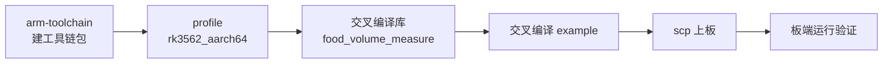

# 交叉编译到 RK3562（aarch64 / Linux）

把 `example`（功能演示）与 `bench`（性能基准）交叉编译到 **RK3562** 板端运行。

| 项 | 值 |
|---|---|
| 目标平台 | RK3562 / ARMv8-A / **64 位** / Linux |
| Conan `arch` | `armv8` |
| 工具链 triplet | `aarch64-none-linux-gnu` |
| 工具链包 | `arm-toolchain/14.3.rel1`（GCC 14.3） |
| 交叉 profile | `../profiles/rk3562_aarch64` |
| 构建目录 | `build/armv8` |

> RK3562 是 64 位 ARMv8-A SoC（Cortex-A53 核），所以用 `arch=armv8`。
> 若你的板子跑的是 32 位用户空间（`uname -m` 返回 `armv7l`），
> 则 `arch` 要改成 `armv7hf`，工具链 triplet 变为 `arm-none-linux-gnueabihf`。

## 流程总览



**依赖链的规模决定了耗时**：`food_volume_measure` 依赖 PCL，而 PCL 的完整依赖闭包有 17 个 Conan 包，全部需要为 aarch64 重新源码编译：

```
pcl/1.14.1
├── boost/1.83.0        ← 最耗时（含 b2 / bison / flex / m4 / gnu-config 构建链）
├── eigen/3.4.1
├── flann/1.9.2
├── qhull/8.0.2
├── zlib/1.3.1  bzip2/1.0.8  lz4/1.9.4  libpng/1.6.58  libbacktrace
├── libpcap/1.10.4      ← 需关闭
├── libusb/1.0.26       ← 需关闭
└── libudev/system      ← 需关闭（system 依赖，交叉时宿主机无 aarch64 版）
```

首次交叉构建预计 **1～2 小时**（瓶颈是 boost）。之后全部命中 Conan 缓存，重编只需几秒。

## 第 1 步：建工具链包（一次性）

`arm-toolchain` 的 recipe 需要通过 `settings_target` 才能选对 triplet，所以**必须**用 `--build-require`：

```bash
cd /home/min/project/arm-toolchain

conan create . -pr:b=default \
  -s:h os=Linux -s:h arch=armv8 -s:h compiler=gcc \
  -s:h compiler.version=14 -s:h compiler.cppstd=gnu17 \
  -s:h compiler.libcxx=libstdc++11 -s:h build_type=Release \
  --build-require --build=missing -c tools.build:jobs=4
```

> ⚠️ `-s:h compiler.version` 必须与 recipe 的 `version` 对应。当前 recipe 产出
> `14.3.rel1`，所以这里是 `14`。版本不匹配时 `validate()` 会直接报
> `Unsupported version`。

验证已进缓存：

```bash
conan list "arm-toolchain/*:*"
# 应看到 settings_target 为 arch: armv8 / os: Linux
```

## 第 2 步：交叉 profile

`../profiles/rk3562_aarch64` 内容如下（已就位）：

```ini
[settings]
os=Linux
arch=armv8
compiler=gcc
compiler.version=14
compiler.cppstd=gnu17
compiler.libcxx=libstdc++11
build_type=Release

[tool_requires]
arm-toolchain/14.3.rel1

[options]
pcl/*:with_libusb=False
pcl/*:with_pcap=False
pcl/*:with_qt=False
pcl/*:with_opengl=False

[conf]
tools.build:jobs=4
```

**两个关键点：**

1. **PCL 的选项必须写进 profile，不能只在命令行上给。**
   Conan 的 `conan create`（编库）和下游 `conan install`（编 example）必须用
   **完全一致**的选项，否则算出的 package_id 不同，Conan 会另编一套二进制，
   或用错版本导致链接失败。写进 profile 就天然一致。

2. **为什么要关这四个选项。**
   - `with_libusb` / `with_pcap`：PCL 1.14 默认 `True`，会引入 `libusb` 与
     `libpcap`，交叉时撞 `libudev` 的 system 依赖，报 libudev 找不到。
   - `with_qt` / `with_opengl`：默认也是 `True`，本库完全不用可视化，
     开着只会白拉 Qt / OpenGL 依赖。

## 第 3 步：交叉编译库

```bash
cd /home/min/project/food_volume_measure

conan create . -pr:b=default -pr:h=../food_volume_measure_test/profiles/rk3562_aarch64 \
  -s build_type=Release --build=missing -c tools.build:jobs=4
```

`test_package` 在检测到 `cross_building` 时会**自动跳过执行**（aarch64 二进制无法在宿主机跑），
只做编译链接验证，所以这一步不会卡住。

> 若 `-pr:h` 相对路径不方便，可写成绝对路径
> `-pr:h=/home/min/project/food_volume_measure_test/profiles/rk3562_aarch64`。

## 第 4 步：交叉编译 example

```bash
cd /home/min/project/food_volume_measure_test/example

conan install . -pr:b=default -pr:h=../profiles/rk3562_aarch64 \
  -of build/armv8 --build=missing -c tools.build:jobs=4

cmake -S . -B build/armv8 \
  -DCMAKE_TOOLCHAIN_FILE=build/armv8/conan_toolchain.cmake \
  -DCMAKE_BUILD_TYPE=Release
cmake --build build/armv8 -j4
```

确认产物架构正确：

```bash
file build/armv8/example
# 期望：ELF 64-bit LSB ... ARM aarch64
```

若非 aarch64，说明 `CMAKE_TOOLCHAIN_FILE` 没生效，检查 `-D` 是否拼错。

## 第 5 步：部署到板子

```bash
cd /home/min/project/food_volume_measure_test/example

scp build/armv8/example build/armv8/bench root@<板子IP>:/root/
scp ../py/test_data/base.pcd root@<板子IP>:/root/
scp ../py/test_data/food/3.pcd root@<板子IP>:/root/
```

## 第 6 步：板端运行与验证

```bash
ssh root@<板子IP>

# 功能演示
/root/example /root/base.pcd /root/3.pcd

# 性能基准（重复 5 次）
/root/bench /root/base.pcd /root/3.pcd 5
```

### 三个验证点

**① 状态不是 `kUnsupportedPlatform`**

库里有 40+ 处 `#ifdef __ARM_EABI__`，走的是「未定义 → 编完整 PCL 路径；
已定义 → 直接返回 `kUnsupportedPlatform`」的分支。**如果这个宏在 aarch64 上被定义，
板端会静默返回「不支持平台」，所有数值字段为 NaN。**

结论（已查证）：GCC 的 aarch64 后端（`gcc/config/aarch64/aarch64-c.cc`）
**不定义** `__ARM_EABI__`，它只定义 `__aarch64__` / `__ARM_ARCH_ISA_A64` /
`__ARM_PCS_AAPCS64` 等。因此 RK3562 走完整 PCL 路径，功能完整。

板端自查一行即可：

```bash
/root/example /root/base.pcd /root/3.pcd | grep -i status
```

**② 体积与真值吻合**

`py/test_data/ground_truth.json` 里 `food/3.pcd` 的真值是 **94.60172933115129 cm³**。
板端 `example` 输出的 `volume_cm3` 应与之吻合。

> 注意：**不要期望与桌面端逐位一致**。交叉编译换了编译器版本（GCC 13 → 14）、
> 目标架构与浮点优化策略，末几位可能有差异（FMA 收缩、向量化等）。
> 判据是「落在浮点精度内」，不是 bit-identical。若差异到小数点后 3 位以上，
> 那才是真的有问题，回头查算法路径（见验证点 ①）。

**③ 耗时可比对**

`bench` 会打印端到端 `run()` 耗时、CPU 时间与峰值内存。RK3562 的 A53 与
桌面 x86_64 的差距是预期内的；重点是确认**没有数量级异常**（如耗时暴涨或内存溢出）。

## 常见问题

| 现象 | 原因与处理 |
|---|---|
| `Unsupported version ...` | `arm-toolchain` 版本与 `-s:h compiler.version` 不匹配，见第 1 步的警告 |
| `libudev` 找不到 | PCL 的 `with_libusb`/`with_pcap` 没关。确认 profile 的 `[options]` 段生效 |
| 链接期 VFP / 浮点 ABI 不匹配 | toolchain、库、消费方的 `compiler.*` 与 `build_type` 三者不一致，重编时保持 profile 完全相同 |
| `file` 显示 x86-64 | `CMAKE_TOOLCHAIN_FILE` 未生效，重新跑第 4 步的 `cmake -S . -B ...` |
| 板端 `volume_cm3` 为 `nan` | 见验证点 ①，检查是否误走 `kUnsupportedPlatform` |
| 板端报 `GLIBC_x.xx not found` | 工具链自带的 glibc 比板子上的新。需用板子系统同版本或更旧的工具链重建 |

## 缓存与重新构建

Conan 按 `package_id` 缓存二进制。**改任何影响 ABI 的配置**（`compiler.version`、
`compiler.libcxx`、`build_type`、PCL 选项）都会导致缓存未命中并重编。
想把库强制重建一次：

```bash
conan create . -pr:b=default -pr:h=../food_volume_measure_test/profiles/rk3562_aarch64 \
  -s build_type=Release --build=food_volume_measure/* -c tools.build:jobs=4
```

> 注意 `--build=food_volume_measure/*` 只重建本库，不动 PCL。
> 若要把 PCL 一起重建（例如改了 PCL 选项），用 `--build=missing` 或显式
> `--build=pcl/*`。

## 相关文档

- `README.md` — 桌面 x86_64 与 RK3562 两套目标的总体说明
- `../../README.md` — 测试工程总览（目录结构、Python 侧、真值表）
- `../../profiles/rk3562_aarch64` — 交叉 profile 本体
- `/home/min/project/arm-toolchain/README.md` — 工具链 recipe 与 triplet 对照表
